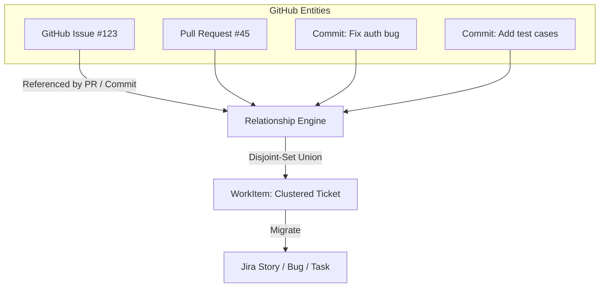

# GitRec: Issue & Commit Backfill to Jira Documentation

This document explains how **GitRec** extracts GitHub Issues, clusters them with commits and pull requests, and migrates them to Jira.

---

## 1. GitHub Issue Extraction

GitRec's [`GitHubExtractor`](file:///home/kailash-bisht/Desktop/GITREC/gitrec/extractors/github_extractor.py) extracts issues via the GitHub REST API (`/repos/{owner}/{repo}/issues`).

* **PR vs. Issue Separation**: GitHub's issues API endpoint returns both PRs and issues. GitRec filters out items containing `pull_request` keys to isolate pure issues.
* **Extracted Fields**:
  * Issue Number & Title
  * Description / Body
  * Author & State (`open`/`closed`)
  * Created & Closed timestamps
  * Labels & Milestones
  * Comment counts & HTML URLs

---

## 2. Relationship Discovery & Union-Find Clustering

GitRec avoids the anti-pattern of creating disconnected, redundant Jira tickets for related commits and issues.

### Clustering Logic ([`grouper.py`](file:///home/kailash-bisht/Desktop/GITREC/gitrec/engine/grouper.py) & [`relationship.py`](file:///home/kailash-bisht/Desktop/GITREC/gitrec/engine/relationship.py)):
1. **Explicit Regex Matching**: Detects patterns in commit messages and PR bodies like:
   * `Fixes #123`, `Closes #123`, `Resolves #123`, `Ref #123`
2. **Entity Grouping (Disjoint-Set / Union-Find)**:
   * The issue, its resolving PR, and all associated commits are merged into a single logical `WorkItem`.
3. **Title & Summary Hierarchy**:
   * If a cluster contains an issue, the **Issue Title & Description** take precedence as the primary title/description for the Jira ticket (providing cleaner, human-written context compared to raw commit messages).
4. **Standalone Issues**:
   * Issues without linked commits or PRs are preserved as independent `WorkItem`s so no issue is lost.

---

## 3. Classification & Scoring

Each clustered work item undergoes automated classification and confidence scoring:

* **11 Work Categories**: Classified into *Feature, Bug, Refactor, Performance, Security, Infrastructure, Documentation, Test, Maintenance, Improvement, or Unknown* using commit messages, labels, and file paths.
* **Explainable Evidence**: Generates evidence tags (e.g. `Associated with Issue(s): #123`, `Associated with PR(s): #45`, `Grouped 3 related commits`).

---

## 4. Jira Ticket Creation & Traceability

During migration ([`jira/migrator.py`](file:///home/kailash-bisht/Desktop/GITREC/gitrec/jira/migrator.py)):

### Issue Type Mapping
* `FEATURE` $\rightarrow$ **Story**
* `BUG` / `SECURITY` $\rightarrow$ **Bug**
* `REFACTOR` / `PERFORMANCE` / `TASK` $\rightarrow$ **Task**

### Jira Ticket Contents
Each created Jira ticket includes:
* **Summary**: `[<Item_ID>] <Issue/Work Title>`
* **Description**: Complete issue description with a **Traceability & Git Evidence** section:
  * Confidence score & category
  * Original GitHub Issue links (`#123`)
  * Pull request numbers & Commit SHA references
  * Author attribution & timestamps
  * Modified modules and files
* **Labels**: `gitrec-backfill` and original GitHub issue labels.

### Idempotency
All created Jira keys (e.g., `PROJ-101`) are persisted locally in SQLite (`owncast_store.db`), ensuring duplicate tickets are never created upon re-runs.
