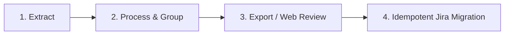

# GitRec: Git History to Jira Backfill Pipeline

**GitRec** extracts an existing Git/GitHub repository's full commit and PR/Issue history, clusters related commits into logical work items (avoiding the 1-commit = 1-ticket anti-pattern), classifies each work item into 11 engineering categories, scores confidence with explainable evidence, allows human review/editing via a modern Web Studio, and idempotently migrates approved work items to Jira.

---

## ⚡ Quick Start

### 1. Installation
```bash
# Create and activate virtual environment
python3 -m venv .venv
source .venv/bin/activate

# Install gitrec in editable mode
pip install -e .
```

---

## 🛠️ CLI Usage & Workflow

The pipeline follows the exact 5-step lifecycle:



### 1. Extract History
Extract local Git repository history and (optionally) GitHub PRs/issues:
```bash
# Extract local git repo
gitrec extract --repo-path /path/to/your/git-repo

# (Optional) Extract with GitHub PRs and Issues
gitrec extract --repo-path /path/to/your/git-repo --github-repo "owner/repo" --github-token "YOUR_GH_TOKEN"
```

### 2. Group & Classify Work Items
Runs relationship detection, disjoint-set grouping, categorization into 11 work types (*Feature, Bug, Refactor, Performance, Security, etc.*), and confidence scoring:
```bash
gitrec process --proximity-hours 24
```

### 3. Export for Review
Generate standard CSV and JSON datasets for audit or spreadsheet review:
```bash
gitrec export --json-out work_items_review.json --csv-out work_items_review.csv
```

### 4. Interactive Review Studio (Web UI)
Launch the local web dashboard to review, edit titles, adjust classification types, and mark items as Approved/Excluded:
```bash
gitrec review --port 5000
```
Open **http://127.0.0.1:5000** in your browser.

### 5. Migrate to Jira
Idempotently migrate approved work items to your Jira board:
```bash
# Dry Run (Test field mappings & preview without making changes)
gitrec migrate --jira-url "https://your-domain.atlassian.net" --project-key "PROJ" --dry-run

# Live Migration
gitrec migrate \
  --jira-url "https://your-domain.atlassian.net" \
  --project-key "PROJ" \
  --email "your-email@company.com" \
  --api-token "YOUR_JIRA_API_TOKEN"
```

---

## 🧪 Testing

Run test suite:
```bash
pytest
```
